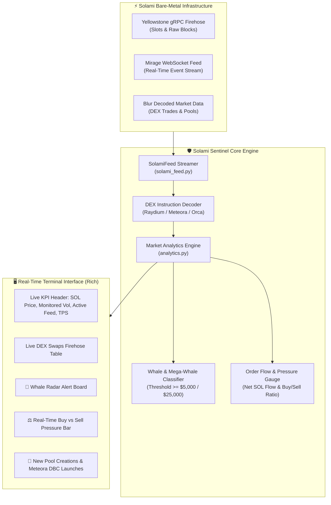

# ⚡ Solami Sentinel

> **Autonomous Real-Time Solana DEX Firehose & Whale Radar**  
> *Built for the [Colosseum Crypto World's Fair](https://earn.superteam.fun/earn/hackathon/crypto-worlds-fair) — [Solami Infrastructure Sidetrack](https://earn.superteam.fun/listings/bounties/build-something-live-on-solana-data).*

[](#)
[](#)
[](#)
[](https://opensource.org/licenses/MIT)

---

## 🎯 Overview

**Solami Sentinel** is an ultra-low latency, real-time command line terminal dashboard and surveillance engine for the Solana blockchain. Powered by **Solami's bare-metal infrastructure** (Yellowstone gRPC firehose, Mirage WebSockets, and Blur decoded market data), Sentinel provides institutional-grade market visibility for traders, liquidity providers, and on-chain researchers.

Instead of waiting for delayed polling or clunky block explorers, **Solami Sentinel** decodes DEX swaps, monitors large institutional whale movements ($5,000+ and $25,000+), tracks new liquidity pool creations (including Meteora Dynamic Bonding Curves and Raydium CPMM), and calculates live order flow sentiment (Buy vs Sell pressure) directly in your terminal.

---

## 🏗️ Architecture



---

## ✨ Key Features

1. **🔥 High-Frequency DEX Stream (Blur & Yellowstone):**
   * Decodes trades in real-time across **Raydium AMM v4**, **Raydium CPMM**, **Meteora DBC**, **Meteora DLMM**, and **Orca Whirlpools**.
   * Identifies exact token routes (e.g. `SOL → JUP`, `WIF → SOL`), trade sizes, and on-chain transaction signatures.

2. **🐋 Whale Radar & High-Conviction Flow:**
   * Instant highlight and auditory tagging for high-conviction trades:
     * `🐋 WHALE`: Swaps exceeding **$5,000 USD**.
     * `🚨 MEGA`: Institutional orders exceeding **$25,000 USD**.
   * Surfaces trader wallet addresses and execution venues.

3. **⚖️ Real-Time Order Flow Sentiment Gauge:**
   * Tracks net inflow/outflow of SOL and SPL tokens.
   * Real-time graphical sentiment bar visualizing Buy Volume % vs Sell Volume % across active DEX markets.

4. **🌱 New Liquidity Pool Radar (Meteora DBC & Raydium):**
   * Monitors new pool initializations the second they land on-chain.
   * Tracks initial liquidity depth in USD to filter out low-quality spam.

5. **🔄 Dual Execution Engine:**
   * **Live Mainnet Mode:** Direct connection to Solami Pro Mirage/Blur endpoints or Solana Mainnet WebSocket.
   * **Replay / Demo Buffer Mode:** Built-in high-fidelity replay simulator so hackathon evaluators can test and demonstrate the full interface immediately without needing to configure API keys or exhaust quotas.

---

## 🚀 Quickstart Guide

### 1. Clone & Setup

```bash
git clone https://github.com/Overloade1212/solami-sentinel.git
cd solami-sentinel

# Create and activate virtual environment
python3 -m venv venv
source venv/bin/activate

# Install dependencies
pip install -r requirements.txt
```

### 2. Configure Solami API Key (Optional)

Create a `.env` file (or set environment variables):

```bash
cp .env.example .env
```

```env
# Solami Pro API key (get free 7-day Pro at https://solami.dev/signup?ref=st-earn-sep-26)
SOLAMI_API_KEY=your_solami_api_key_here

# Detection Thresholds
WHALE_THRESHOLD_USD=5000.0
MEGA_WHALE_THRESHOLD_USD=25000.0
```

### 3. Launch Sentinel

#### Demo Mode (Instant Evaluation & Showcase):
```bash
python sentinel.py --demo
```

#### Live Mainnet Mode:
```bash
python sentinel.py --live --api-key YOUR_SOLAMI_KEY
```

#### Custom Whale Threshold ($10,000+):
```bash
python sentinel.py --min-whale 10000
```

---

## 🧪 Testing

Solami Sentinel includes an automated unit test suite verifying the analytics engine, whale classification logic, and pool tracking:

```bash
python tests/test_sentinel.py
```

Expected output:
```text
✅ All Solami Sentinel unit tests passed successfully!
```

---

## 📜 Project Structure

```text
SolamiSentinel/
├── config.py             # Solami endpoints, DEX program IDs & threshold config
├── analytics.py          # TradeEvent models, whale detection & sentiment math
├── solami_feed.py        # Solami Mirage/Blur streamer & mainnet replay engine
├── ui.py                 # Bloomberg-style Terminal UI powered by Rich
├── sentinel.py           # CLI entry point with live event loop
├── requirements.txt      # Python dependencies (rich, websockets, aiohttp)
├── .env.example          # Sample environment configuration
├── tests/
│   └── test_sentinel.py  # Unit test verification suite
└── README.md             # Project documentation
```

---

## 👨‍💻 Author

* **Anatoli Kolotovkin** ([@Overloade1212](https://github.com/Overloade1212))
* Submission for **Superteam Earn — Colosseum Crypto World's Fair Hackathon**

## 📄 License

This project is licensed under the MIT License - see the [LICENSE](LICENSE) file for details.
